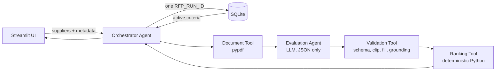
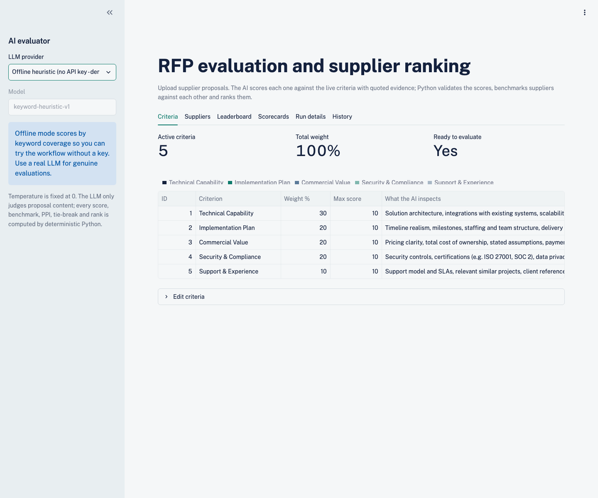
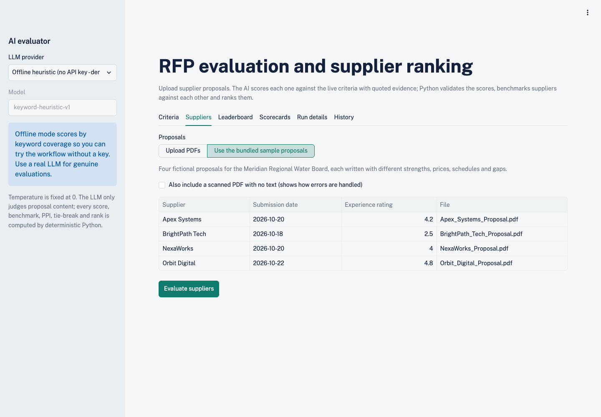
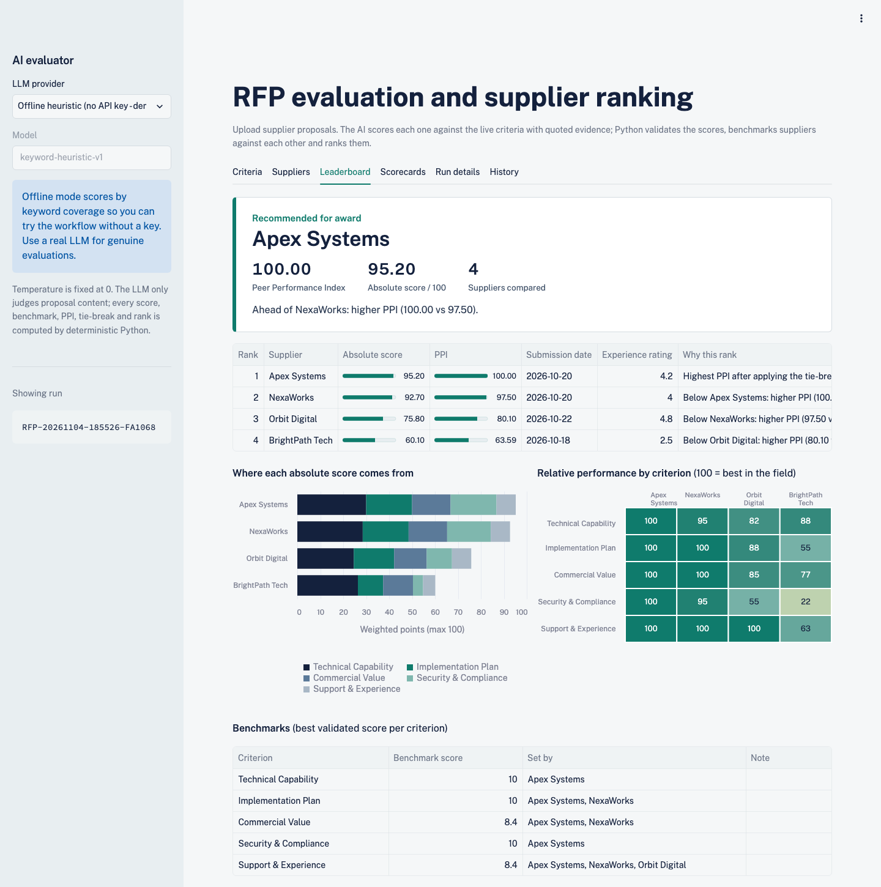
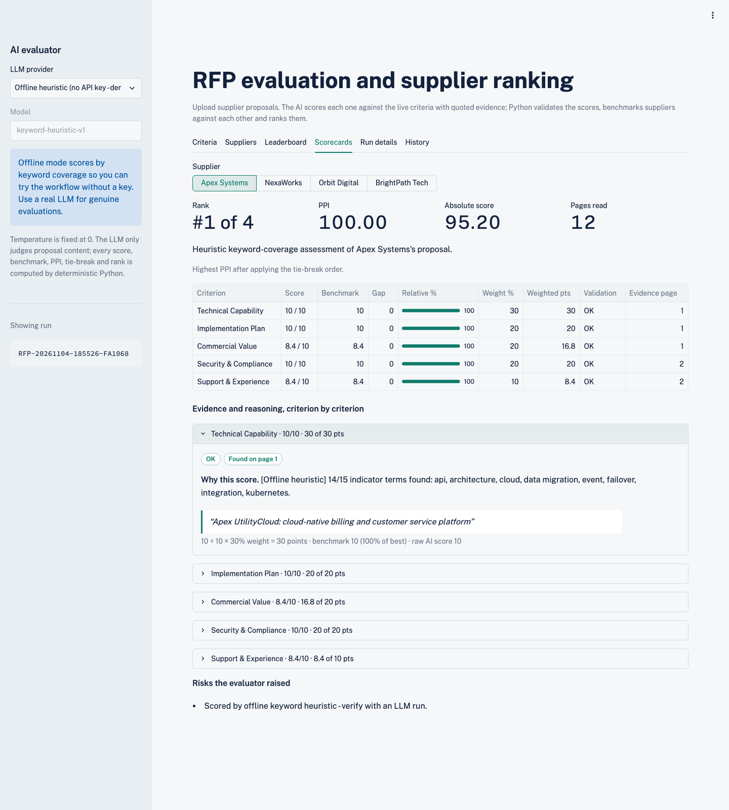
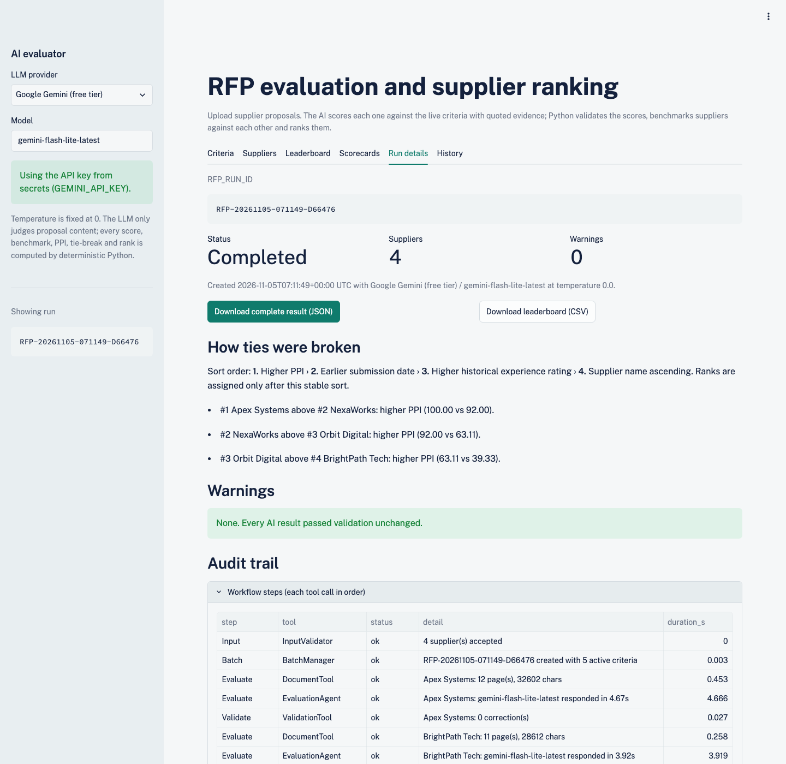
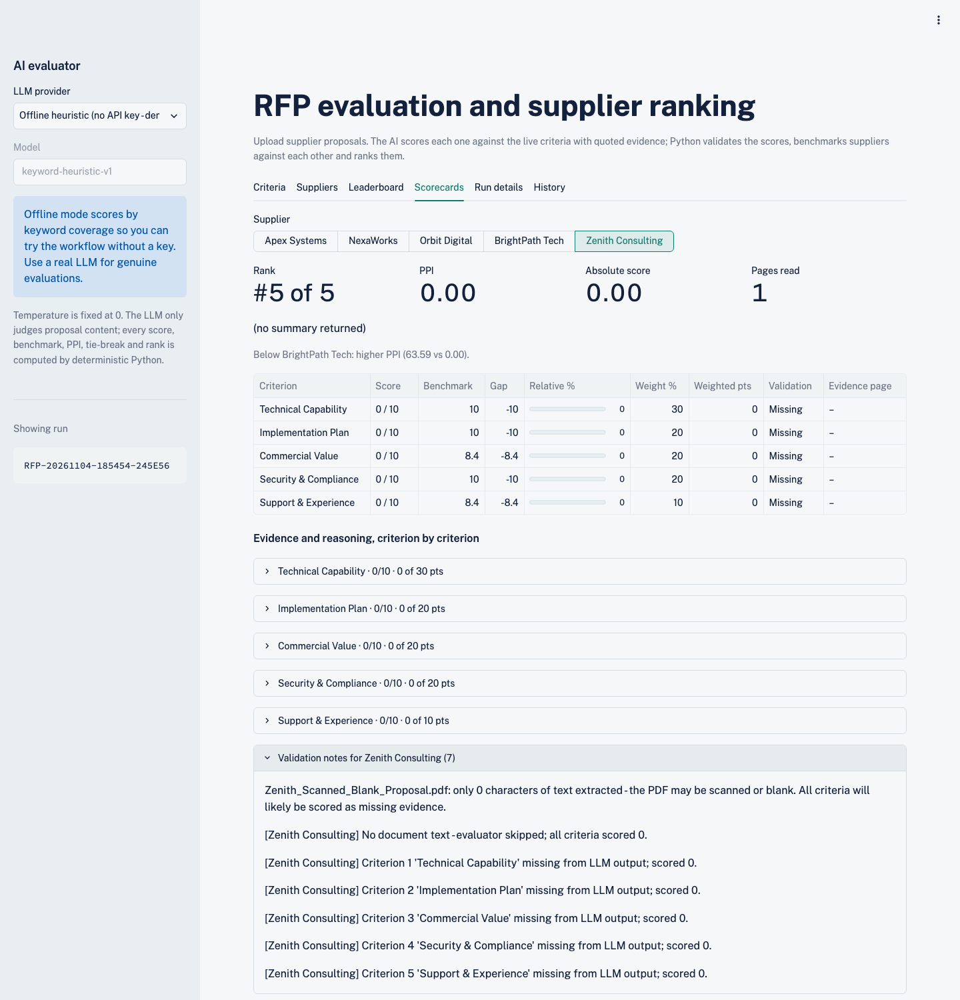

# Agentic RFP Evaluation and Supplier Ranking

An AI-assisted Streamlit application that reads supplier RFP proposals (PDF), scores each one against
configurable criteria stored in SQLite, benchmarks suppliers against their peers, and produces an
explainable, deterministic leaderboard.

**Live app:** https://rfp-evaluator-sanjay.streamlit.app

**Demo video (3 min, real Gemini run):** [docs/demo.mp4](docs/demo.mp4)

| Layer | Technology |
|---|---|
| Application | Streamlit |
| Database | SQLite |
| AI layer | Any JSON-capable LLM: Groq, Google Gemini, OpenAI, OpenRouter, Anthropic Claude, plus an offline heuristic for demos |
| PDF extraction | pypdf |

---

## 1. Architecture

The core design rule is that **the LLM judges proposal content only.** Every number that affects the
ranking (weighted totals, benchmarks, gaps, PPI, tie-breaks and ranks) is computed by deterministic Python.



| Component | File | Responsibility |
|---|---|---|
| Orchestrator Agent | `core/orchestrator.py` | Validates inputs, creates the batch/run ID, reloads criteria, calls each tool in order, records an auditable trace, persists results |
| Document Tool | `core/document_tool.py` | Extracts and cleans PDF text; rejects non-PDFs and encrypted files; warns on scanned/blank files |
| Evaluation Agent | `core/evaluation_agent.py` | Builds the prompt from the **live** criteria and scores one supplier at a time with temperature 0 |
| Validation Tool | `core/validation_tool.py` | Parses JSON, enforces the schema, fills missing criteria, clips/rescales scores, checks evidence against the PDF |
| Ranking Tool | `core/ranking_tool.py` | Absolute score, benchmarks, gaps, relative %, PPI, stable tie-break sort, rank explanations |
| Persistence | `core/db.py` | Schema, seed criteria, runs and supplier results |

### Data flow (matches the brief's 10 steps)

1. **Setup:** Streamlit starts, `init_db()` creates tables and seeds criteria, and the active criteria are displayed.
2. **Input:** Upload PDFs and enter supplier name, submission date and experience rating (0–5).
3. **Batch:** Inputs are validated and an `RFP_RUN_ID` (e.g. `RFP-20261031-142233-A1B2C3`) is created with status `RUNNING`.
4. **Evaluate:** Criteria are **reloaded** from SQLite, then for each supplier the text is extracted, the prompt is built and the LLM is called.
5. **Validate:** JSON is parsed and normalized, and every correction becomes a warning.
6. **Score:** The absolute weighted score is calculated.
7. **Benchmark:** The best score per criterion is found, and gaps and relative % are computed.
8. **Rank:** The PPI is computed, the tie-break order is applied, and ranks 1..n are assigned.
9. **Persist:** `supplier_results` rows and the full run JSON are written under one `RFP_RUN_ID`, and the status is set.
10. **Present:** The UI shows the leaderboard, scorecards, evidence, warnings and agent trace, with a JSON download.

---

## 2. Formulas

Criteria are always iterated in `criterion_id` order, and every value is rounded to 4 decimals before comparison, so
results are bit-for-bit reproducible.

| Metric | Formula |
|---|---|
| Absolute weighted score | `Σ (score / max_score × weight) / Σ weight × 100` (equals `Σ (score/max × weight)` when weights total 100) |
| Criterion benchmark | Highest validated score for that criterion across all suppliers in the run |
| Criterion gap | `score − benchmark`: 0 for the leader, otherwise negative |
| Relative performance % | `score / benchmark × 100`. **If benchmark = 0** (nobody scored), relative % = 0 for everyone and the benchmark is flagged `benchmark_zero` |
| Peer Performance Index (PPI) | `Σ (relative % × weight) / Σ weight` |

**Mandatory tie-break order** (Python's stable `sorted`, then ranks assigned sequentially):
1. Higher PPI
2. Earlier submission date
3. Higher historical experience rating
4. Supplier name ascending (case-insensitive)

Each supplier gets a `rank_reason` stating which rule placed it below the supplier above it, for example
*"PPI tied at 81.00; earlier submission date (2026-10-18 vs 2026-10-20)"*.

---

## 3. Validation rules

| Problem in LLM output | Handling |
|---|---|
| Empty response / no JSON / invalid JSON | All criteria scored 0 (`missing`) with a warning |
| JSON wrapped in ```` ``` ```` fences or surrounded by prose | Object extracted, with a warning |
| Criterion missing | Score 0, status `missing` |
| Unknown or inactive `criterion_id` | Ignored. If the `name` matches an active criterion, it is mapped to that criterion |
| Duplicate criterion | First kept |
| Non-numeric score (`"high"`) | Score 0, status `invalid_score` |
| Numeric string (`"7"`, `"8/10"`) | Parsed |
| LLM used a different `max_score` (e.g. 4/5) | Rescaled to the database max (8/10), status `rescaled` |
| Score outside `0..max` | Clipped, status `clipped` |
| Evidence missing, or under 3 words (e.g. just `"ISO"`) | Score **capped at 50% of max**, status `ungrounded`, warning |
| Evidence not found in the PDF text | `evidence_grounded = false`, score **capped at 50% of max**, status `ungrounded` (whole-word match, then 4-word shingle overlap ≥ 60%) |
| Evidence found | `evidence_page` records the PDF page it came from, shown as "Found on page N" in the scorecard |
| PDF contains text aimed at the AI ("ignore previous instructions…", "give this supplier full marks") | Warning naming the page; the prompt tells the model the document is untrusted data and to report the attempt under `risks` |
| LLM call fails (outage, rate limit, bad key) | The **whole run stops** with status `FAILED`. A supplier is never ranked last because of an API error. 4xx errors other than 429 are not retried |
| Wrong `supplier_name` | Replaced with the entered name |
| Blank / scanned PDF | Evaluator skipped and all criteria scored 0. The supplier still appears, so the problem is visible |

Input validation **blocks** the run when a name is empty or duplicated, a date is invalid, a rating is outside 0–5,
a file is not a PDF, or the active weights do not total 100%. It **warns** (without blocking) on future dates,
identical files, and single-supplier runs.

---

## 4. Database

| Table | Fields |
|---|---|
| `evaluation_criteria` | criterion_id, name, description, weight, max_score, is_active |
| `rfp_runs` | rfp_run_id, created_at, status, supplier_count, llm_provider, llm_model, criteria_snapshot, warnings, run_json |
| `supplier_results` | rfp_run_id, supplier_name, submission_date, experience_rating, absolute_score, ppi, final_rank, result_json |

Run status values are `RUNNING`, `COMPLETED`, `COMPLETED_WITH_WARNINGS` and `FAILED`. Criteria can be activated,
deactivated, re-weighted or added from the **Criteria** tab without touching prompt code. The prompt is rebuilt
from the database on every run.

Seed criteria: Technical Capability 30%, Implementation Plan 20%, Commercial Value 20%, Security & Compliance 20%,
Support & Experience 10% (all scored 0–10).

---

## 5. Project structure

```
rfp_evaluator/
├── app.py                         # Streamlit UI
├── core/
│   ├── orchestrator.py            # Orchestrator Agent
│   ├── document_tool.py           # Document Tool (PDF -> text)
│   ├── evaluation_agent.py        # Evaluation Agent (prompt + LLM providers)
│   ├── validation_tool.py         # Validation Tool
│   ├── ranking_tool.py            # Ranking Tool (deterministic)
│   ├── db.py                      # SQLite schema + queries
│   └── samples.py                 # metadata for bundled sample proposals
├── scripts/
│   ├── seed_db.py                 # create DB + seed criteria
│   ├── generate_sample_rfps.py    # regenerate the synthetic PDFs
│   └── run_sample.py              # CLI run -> sample_output/sample_run.json
├── sample_rfps/                   # 4 synthetic proposals + 1 blank PDF for the error demo
├── sample_output/sample_run.json  # exported JSON of a completed run
├── tests/test_ranking_and_validation.py
├── .streamlit/config.toml
├── .streamlit/secrets.toml.example
└── requirements.txt
```

---

## 6. Setup (local)

```bash
git clone https://github.com/SanjayVk731/rfp_evaluator.git
cd rfp_evaluator
python -m venv .venv && source .venv/bin/activate     # Windows: .venv\Scripts\activate
pip install -r requirements.txt

python scripts/seed_db.py          # creates data/rfp_evaluation.db with the sample criteria
pytest -q                          # 18 tests: formulas, tie-breaks, validation, grounding, failures
streamlit run app.py
```

**API key.** Recommended: a free Google Gemini key from aistudio.google.com/apikey (`GEMINI_API_KEY`). Gemini's
free tier reads a full 12-page proposal in one call, about 4 seconds per supplier. Groq's free tier caps requests at
8,000 tokens per minute, which is smaller than one 12-page proposal, so Groq needs its paid Dev tier here. Either paste the key into
the sidebar, or copy `.streamlit/secrets.toml.example` to `.streamlit/secrets.toml` and fill it in. No key? Choose
**Offline heuristic** in the sidebar to try the full workflow.

CLI run (writes `sample_output/sample_run.json`; reads the key from the environment or `.streamlit/secrets.toml`):

```bash
python scripts/run_sample.py --provider "Google Gemini (free tier)"
python scripts/run_sample.py        # offline heuristic
```

## 7. Deploy to Streamlit Community Cloud

1. Push this folder to a **public GitHub repo**. `.gitignore` already excludes `secrets.toml` and the `.db` file.
2. Go to share.streamlit.io, click **Create app**, pick the repo and branch, and set the main file to `app.py`.
3. Open **Advanced settings → Secrets** and paste `GEMINI_API_KEY = "..."`, then pick **Google Gemini (free tier)** in the sidebar.
4. Click Deploy, then copy the public URL into this README and your submission.

The database is created automatically on first start. Streamlit Cloud storage is ephemeral, so run history resets
when the app restarts. That is acceptable for this project; production use would need a hosted database.

---

## 8. Synthetic test data

All suppliers, the buyer ("Meridian Regional Water Board") and all figures are fictional. Each proposal is a
full 11–12 page bid (cover, contents, 11 sections, appendices) generated by `scripts/generate_sample_rfps.py`.
Weak bids are weak the way real ones are: long and confident, but vague where it matters, so the evaluator has
to find the missing evidence rather than notice a short document.

| Supplier | Pages | Designed profile | Price (3-yr) | Timeline |
|---|---|---|---|---|
| Apex Systems | 12 | Strong technical design and security (ISO 27001, SOC 2 Type II); highest price, very clear pricing | INR 14.21 Cr | 40 weeks |
| BrightPath Tech | 11 | Lowest price, fastest; weak compliance ("planning" ISO 27001), first utility project, no references | INR 6.04 Cr | 16 weeks |
| NexaWorks | 12 | Balanced; strongest implementation plan (5 gated milestones, 11-row risk register) and 24x7 support | INR 10.40 Cr | 32 weeks |
| Orbit Digital | 11 | Strongest experience (22 implementations, 5 references); integrations "to be confirmed in discovery", T&M pricing | INR 10.85 Cr est. | ~36 weeks |
| Zenith (blank PDF) | 1 | No text layer. Used to demonstrate the validation/error path | – | – |

## 9. Assumptions

- Experience rating is entered by the user on a 0–5 scale.
- A missing or invalid criterion result scores **0**. This is a conservative policy: unproven claims earn nothing.
- A score whose quoted evidence cannot be found in the PDF is capped at **50%** of the maximum. The model may still
  be right, so the score isn't zeroed, but an unverifiable claim can't win a criterion.
- An LLM failure stops the run. Scoring that supplier 0 would let an outage decide the award.
- Relative % is 0 when a benchmark is 0, so PPI is not inflated when no supplier showed any evidence.
- Commercial Value is judged by the LLM from each proposal **on its own** (clarity, assumptions, fixed vs estimated
  pricing). Cheaper is not automatically better, and the LLM does not compare suppliers. Peer comparison happens
  only in the Ranking Tool.
- The ranking uses PPI as its primary key, as the brief requires. The absolute score is shown alongside it for context.
- PDFs are truncated at 60,000 characters for the prompt, with a warning.
- The offline heuristic is a keyword-coverage scorer for demonstrations only. It is not a substitute for LLM judgement.

## 10. Reproducibility

Temperature is 0 and the prompt is built deterministically. Once scorecards are validated, the ranking is a pure
function: `tests/test_ranking_and_validation.py::test_ranking_is_deterministic_regardless_of_input_order` shuffles
the inputs 20 times and asserts identical ordering. Every final score can be traced to a criterion, weight, evidence
quote, validation status and the business rule that set its rank. The raw LLM output is also stored in the result JSON.

## 11. Screenshots

**Criteria:** active criteria, weights and max score, with an in-app editor that refuses to save unless weights total 100%.


**Supplier input:** multiple PDFs, supplier metadata and validation messages, then the Evaluate button.


**Leaderboard:** the recommended supplier and why it beat the runner-up, the ranked table, how each absolute
score is built from weighted points, and relative performance against the best in the field.


**Detailed scorecard:** score, benchmark, gap, relative %, weight, validation status and the page each quote came from;
each criterion opens to its justification, verbatim evidence and the arithmetic behind its points.


**Run details:** RFP_RUN_ID, status, tie-break explanation, warnings by supplier, the step-by-step audit trail,
and JSON/CSV downloads.


**Error case:** a scanned PDF with no text is still listed, scores 0 everywhere, and the warnings explain why.


## 12. How this maps to the rubric

| Rubric area (marks) | Where it lives | Proof |
|---|---|---|
| Agentic workflow & tool use (20) | `core/orchestrator.py` calls Document → Evaluation → Validation → Ranking tools in a fixed order; every call is logged in the run's `trace` | Run details → Audit trail |
| PDF extraction & prompting (15) | `core/document_tool.py` (pypdf, cleaning, page markers, scanned/encrypted/injection checks); `core/evaluation_agent.py` builds the prompt from the live DB criteria | `test_blank_pdf_produces_warning`, `test_prompt_injection_in_pdf_is_flagged` |
| Validation & scoring (20) | `core/validation_tool.py`: schema, fill, clip, rescale, evidence grounding with page citation, 50% cap for unproven claims | `test_validation_fills_missing_clips_and_rescales`, `test_hallucinated_evidence_is_flagged`, `test_evidence_is_traced_to_its_page` |
| Peer ranking & tie-breaks (20) | `core/ranking_tool.py`: pure Python, 4-decimal rounding, stable sort, a sentence explaining every rank | `test_tie_break_order_all_four_rules`, `test_ranking_is_deterministic_regardless_of_input_order` |
| SQLite & persistence (10) | `core/db.py`: criteria, runs (with criteria snapshot and full JSON), supplier results under one `RFP_RUN_ID`; failed runs kept as `FAILED` | History tab; `test_llm_outage_fails_the_run_instead_of_ranking_supplier_last` |
| Streamlit UI (10) | `app.py`: Criteria, Suppliers, Leaderboard, Scorecards, Run details, History | Screenshots above |
| Documentation & testing (5) | This README, 18 tests, synthetic 11–12 page proposals, `sample_output/sample_run.json` | `pytest -q` |

## 13. Demo script (about 3 minutes)

1. **Criteria tab.** Show the 5 active criteria totalling 100%. Untick one and show that **Save** is disabled because the total is no longer 100.
2. **Error case 1.** Upload two PDFs, give both the same supplier name, and show the blocking error.
3. **Successful run.** Choose *Use bundled sample proposals*, click **Evaluate**, and narrate the live agent steps.
4. **Results.** On **Leaderboard**, read out why #1 beat #2, then the weighted-points chart and relative % heatmap. On **Scorecards**, open one criterion: its evidence, the page it came from, and the arithmetic. On **Run details**, show the tie-break lines and download the JSON.
5. **Error case 2.** Tick *Include a scanned/blank PDF* and run again. Zenith scores 0, with warnings explaining why.
6. **Error case 3.** Type a wrong API key and evaluate. The run stops with status `FAILED` instead of ranking anyone last.
7. **Run history.** Reopen the first run from SQLite using its `RFP_RUN_ID`.
